# Towards Mastering Scrabble with Search and an Exact Endgame

In 2015, Nigel Richards won the French-language World Scrabble Championship. He [doesn't speak French](https://www.cnn.com/2015/07/22/world/french-scrabble-champion-nigel-richards). He spent about nine weeks with the French word list and then won the title.

This is the video that got me hooked on the problem. Watch him in action:



Nigel has been [world champion five times](https://en.wikipedia.org/wiki/Nigel_Richards), in 2007, 2011, 2013, 2018 and 2019. The level of insight, strategy and just the way Nigel plays is something out of this world. That got me thinking about why some games are so hard for a computer. Computers mastered chess long ago, and DeepMind's AlphaGo did the same for Go, so why are games like Scrabble or poker still hard for computers to make sense of? One answer is that these aren't exact games. They involve luck and hidden information, so there's no clean way to say which move is right, and no single Stockfish that is clearly the best in the world. Games like this test a program on two axes. One is knowing the rules. The other is deciding which move to make given what you've drawn. In Scrabble, that means knowing the legal moves from the dictionary, and then, given the tiles you drew, making the best one.

For a game solver, getting the first skill is almost free: load the dictionary and it knows every word. The second axis is the whole game, and this post is my attempt to understand how we can create a game solver that plays world-class Scrabble. Since I'm a big fan of solving problems using discovery agents, I used my own AlphaEvolve-style library, [cadence](https://github.com/yash-srivastava19/cadence), and pushed it to the limit to learn Scrabble strategy. The whole idea of cadence is simple - you give it a program, a way to score it and a sandbox, and it asks a model to improve the program one measured change at a time. I've written about its [design](cadence_blog) and about [running it on benchmark puzzles](evolving_problems_cadence). This pushes cadence to its limit because those benchmarks didn't involve luck or an opponent, and Scrabble has both.

This blog takes you on the journey of how my game solver beats HastyBot, the quick bot from the [Macondo](https://github.com/domino14/macondo) engine, and how it plays level with a stand-in for BestBot, Macondo's strongest bot.

Try a puzzle yourself on [Rackoon](https://rackoon.vercel.app) · the search tool: [cadence](https://github.com/yash-srivastava19/cadence) · the problems it runs on: [cadence-problems](https://github.com/yash-srivastava19/cadence-problems)

## How to play Scrabble

A game of Scrabble is two players, a 15×15 board, and a bag of 100 tiles. The rest of this post leans on a handful of rules, so here they all are:

- **The tiles are fixed and public.** Every game uses the same 100 tiles, and the rules say exactly how many of each letter there are: one Q, one Z, two blanks, and so on. Each tile has a point value. Rare letters are worth more (Q and Z are 10, E is 1), and a blank can stand for any letter but scores 0.
- **Your rack.** Each player holds seven tiles, hidden from the other player. The rest wait face down in the bag, in an order nobody knows.
- **A turn.** You place some of your tiles in one straight line, joined to the tiles already on the board, so that every new word they make is a real word. You score those words, then draw from the bag until you have seven tiles again. Instead of playing, you can **swap** some of your tiles for new ones from the bag, scoring nothing, or pass.
- **What you keep.** The tiles left on your rack after a play are your **leave**. Fresh tiles from the bag join them for your next turn.
- **Premium squares.** Some squares double or triple a letter, or a whole word. They only count on the turn you cover them, and a triple-word square can turn a modest word into a big score. Placing a tile that lets your opponent reach one is called *opening* it.
- **Bingo.** Using all seven tiles in one turn is worth 50 extra points.
- **The end.** Once the bag is empty, nobody draws any more. The game ends when one player has used all their tiles, and they also get twice the value of whatever the other player is still holding. This last stretch, with the bag empty, is the **endgame**.
- **Winning.** The higher score wins. How much you win by is the *spread*, so "10 points a game" in this post means an average margin of 10 points.

Two things are hidden from you all game: the other player's rack, and the order of the tiles in the bag. Almost everything later in this post is about dealing with those two.

The generally accepted strategy in Scrabble is to optimise your **leave**: the tiles you keep after you play. A good leave (a blank, an S, a balanced mix like E R S T) sets up your next turn, often a bingo. A bad one (Q with no U, three I's, all consonants) costs you points for several turns.

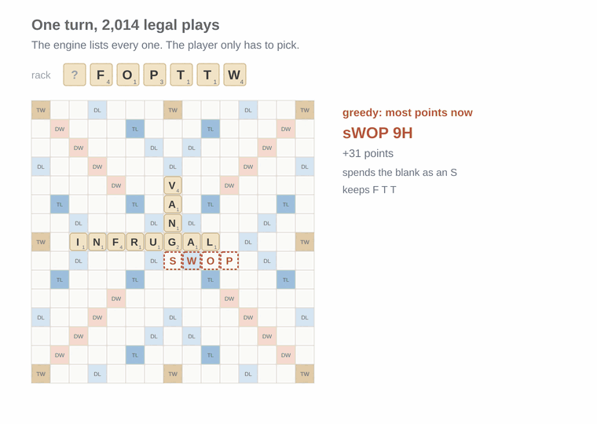

*A real position, replayed by my game solver. Greedy, the player that always takes the most points, spends the blank as an S for 31. The leave bot plays WOP for 23 and keeps the blank. Next turn it plays TIPSTAFF, all seven tiles, for 76.*

Keeping the blank doesn't always pay; the next draw has to cooperate. But a player that only looks at this turn's points can't even see the tradeoff, and good players make it all the time.

To learn Scrabble by playing, head over to [Rackoon](https://rackoon.vercel.app), which gives you one position a day: a board and seven tiles, find the best play. It scores you on points now plus what the tiles you keep are worth, which is the trade discussed above.

### What each player gets to see

My game solver does everything mechanical. It finds every legal move, with the [Appel and Jacobson](https://doi.org/10.1145/42411.42420) algorithm from 1988 that most Scrabble programs build on, and scores each one. On the turn in the above image, there are 2,014 of them. The player is one function that picks one:

```python
def choose(view, moves):
    """Return one of moves."""
```

It's modelled on real life. It sees what a person at the table would see: the board, the scores and its own rack. It can't see the opponent's rack, but it can count. Every game starts with the same 100 tiles, so the opponent's rack and the bag together are something the game solver can reason about, but it can't peek.

> **Assumptions about the game itself**
> - The word list is ENABLE, a free public list. It has no QI or ZA, which tournament players will find odd.
> - Challenges are off. In a real game you can play a made-up word and hope nobody challenges it. Here the engine only offers real words, so bluffing isn't part of the game.
> - The rules, tiles and word list all live in one config file, so the same player can later move to another language.

To create some baselines to beat, I wrote three simple game solvers. **Random** plays any legal word. **Greedy** plays the highest-scoring one. The **leave bot** adds a value for the tiles it keeps: blanks and S good, Q without U bad, duplicates a little bad.

## Luck, and how it influences the game

There are some general heuristics in the game, like: if you draw both blanks, you'll probably win however you play. Most of the difference between two players over a few games is the tiles, not the choices, so luck really does influence the game. But when we're trying to build a game solver, we can't rely on luck. We need benchmark numbers we can trust.

So every match here is played as **duplicate games**: each bag of tiles is played twice, with the players swapping seats. Both get the same tiles in the same order, which counteracts the luck factor.

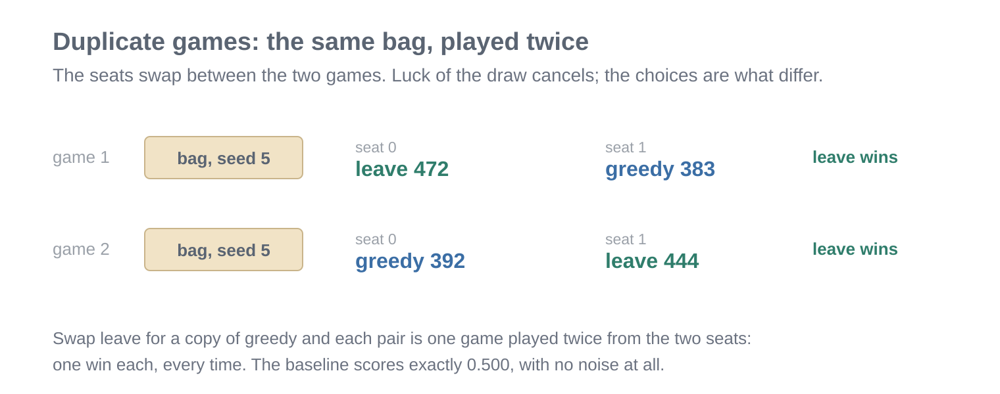

*The same bag played from both seats. The leave bot wins both. If each side had won one, the bag would tell you nothing.*

Duplicate games take out a lot of the luck, but not all of it. A small real difference between two players still takes hundreds, sometimes thousands, of games to show up.

> **How to read the numbers in this post**
>
> A win rate is the share of games won over a whole match. A difference of a few percent over a few hundred games can be luck, so I only trust a result that holds up on fresh bags.

Luck also sneaks in a second way. Say I try five versions of a player on the same games and keep the one that scored best. Part of that score is skill, and part of it is luck. So the winner always looks a __little__ better than it really is.

The fix that I decided on: play the winner again, once, on bags it has never seen. The new games bring new luck, which has nothing to do with the luck that made it look good, so the only thing that carries over is the real skill. It's the difference between a student acing a practice paper they've already seen and acing a test with fresh questions.

Before that rematch, I write down what I expect it to score. That way I can't talk myself into a result after the fact.

This matters because the gaps in this post are tiny, often a percent or two, which is less than the luck in a few hundred games. Both times, the rematch came in lower than the first score: once from 67.5% down to 61%, once from 53% down to 50.5%. Without it, I'd have kept building on wins that never happened.

## Cadence, and how an LLM builds a Scrabble player

The first thing we did to solve Scrabble using cadence was to start from the greedy solver, and let a language model rewrite `choose()` to win more.

Here's how that works. The model can only change one thing: the body of `choose()`. Everything else, the board, the move finder, the scoring, stays mine, so the model can't win by bending the rules. Each attempt goes like this:

1. Cadence shows the model the current player's code and how it scored so far.
2. The model replies with a new version of `choose()` and a short note on what it changed.
3. The new player plays 100 games against greedy: 50 bags, each played from both seats.
4. Its win rate becomes its score, and the next attempt builds on one of the better-scoring versions so far.

> **Assumption: 100 games is enough to compare two attempts**
>
> It wasn't. A 100-game score can be off by about 9 percentage points either way, which is more than most of the changes the model made. That's why fresh-bag rematches matter so much in the next part.

A player that returns a move it wasn't offered loses that game, and one that crashes is recorded as a failure, so a bad reply costs a score, not the whole run. Before letting a real model in, I checked the cadence event loop with scripted replies whose answers I knew. A rewritten greedy scored exactly 50%, the leave bot scored well above it, and a player returning made-up moves forfeited every game without stopping the run.

The model was [Gemini 3.5 Flash](https://deepmind.google/models/gemini/). One thing to keep in mind for what follows: the model only ever sees the score. It never sees a single game it played.

The first real reply jumped straight to roughly where my leave bot sits: **65.5%** against greedy, from one model call. It was textbook Scrabble written as code:

1. give each kept tile a value: blank and S high, Q, V and W low
2. penalise duplicates, and aim for a balanced mix of vowels
3. care less about the leave as the bag empties
4. don't open a triple-word square for the opponent

The first three are my leave bot with different numbers, and the standard advice in Scrabble books. The fourth was new: a fixed penalty for any play that lands near an empty triple-word square.

After that, every reply added more "knobs" with made-up constants: bonuses for keeping **ING** or **ER**, penalties per letter, a defence that tightens when ahead. The scores moved around inside the noise. I kept the best-looking one and called it champion_1. It had scored **67.5%** against greedy. On fresh bags it scored 61% (remember the luck factor), and against my twenty-number table it was level. That's the luck of picking the best of several, in its first appearance.

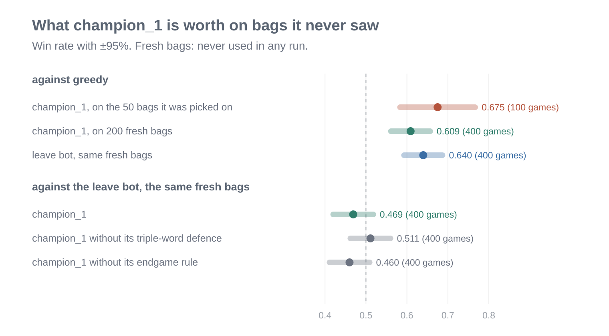

*champion_1 on bags it had never seen. Against greedy it drops from 67.5% to 61%. Against my leave bot it's level, and taking out its triple-word defence or its endgame rule changes nothing you can see.*

The new idea, the defence, made no difference either. Played against a copy of itself without the defence, on 400 games, it came out dead even. Here's a game where it was most active:

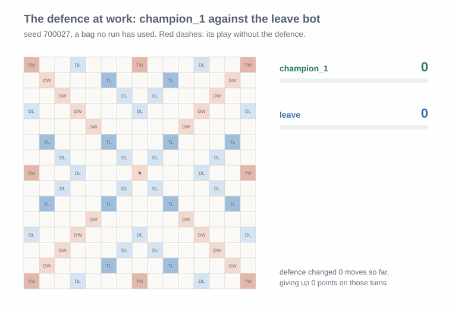

*Picked because the defence changed champion_1's move five times here, so it's not a typical game. Those five turns cost it 44 points. It still won, 468 to 374.*

The turn to watch is where champion_1 holds **RAVENING**, a bingo worth 65. It plays **VARNA** for 27 instead, because **RAVENING** would sit one row from a triple-word square. That's 38 points thrown away to block a square the opponent might never use. The rule doesn't check whether they could. It charges a fixed price for being near one.

The lesson I took: the model's first idea was its best one, because its first idea was what it already knew. After that it was guessing, because all it ever saw was a score. It never saw a single game. Models are a little myopic in this sense.

## What is a tile actually worth?

Every player so far was measured by its results, but the numbers inside them weren't. The leave tables, mine and the model's, came from the same Scrabble wisdom: blank good, Q bad, duplicates a bit bad. That was on purpose at first. My table was meant as a low bar, and the question was whether the model could find better values from the score alone. It couldn't. Its tweaks just moved around inside the luck. This is the tricky part to sieve through, because it means we can sometimes rate a player better than it really is.

Now the actual measurement part kicks in: what is a tile actually worth in real games? Over 5,000 games, at every turn I recorded which tiles the player kept and how many points it scored over its next two turns. Each tile is compared with keeping nothing and drawing fresh, so "a blank is worth 19" means 19 points better than an average new tile. With every turn of 5,000 games behind them, these numbers are far steadier than any guess. And measuring them cost no model calls at all, only engine time.

> **What this measurement assumes**
>
> A tile's worth is judged only by the points over the next two turns, and the games were played by my own bots. So these are good estimates for players like mine, not universal truths about Scrabble.

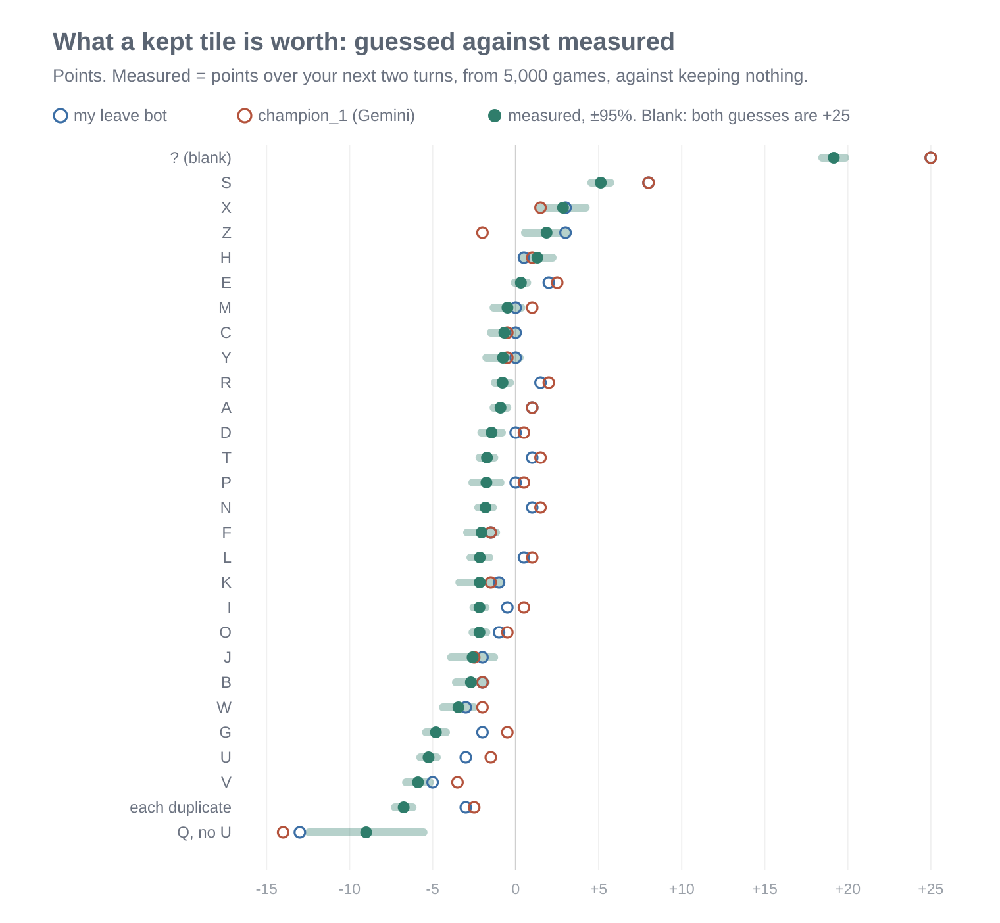

*What a kept tile is worth, measured from 5,000 games, next to the two guessed tables.*

The guesses got the order mostly right and the sizes wrong:

- A blank is worth about 19 points, not 25. An S is worth 5, not 8.
- Common letters like A, R, N and T are slightly *worse* to keep than a fresh draw, and E is worth about nothing. Both guesses had them positive.
- A duplicate costs about 7 points. Both guesses had it at 3 or less.

And then the surprise: a player with the measured values only tied the guessers. If the true values tie the guessed ones, the rack isn't what separates these players any more. What's left is the board: what my move lets the opponent do next. No number attached to a tile can see that.

## Thinking Fast and Slow

When I was thinking about how players play games at a world-class level, the thinking fast and slow approach stood out. A good player does two kinds of thinking. Most moves are quick: you see a play, it looks fine, you put it down. On a hard turn you stop and work it through: if I play here, what can they do with that lane? Daniel Kahneman called these fast and slow thinking in [*Thinking, Fast and Slow*](https://en.wikipedia.org/wiki/Thinking,_Fast_and_Slow), and DeepMind's [AlphaZero](https://doi.org/10.1126/science.aar6404) is built on the same split: a network that judges a position at a glance, and a search that thinks ahead, so it seemed fair to borrow this approach.

**Fast** is the one-look rule: points plus the measured leave. It takes 19 milliseconds a move.

**Slow** takes fast's six favourite moves and imagines 20 possible worlds. In each one it deals the unseen tiles into a random opponent rack, plays the move, lets the opponent reply, and sees where that leaves things. The move with the best average wins. It takes about 14 seconds.

> **What slow assumes**
>
> In each imagined world the opponent replies with the fast rule, not its best possible move, and slow looks only one reply ahead. Twenty worlds per move is also a small sample, so two close moves can still swap places by luck.

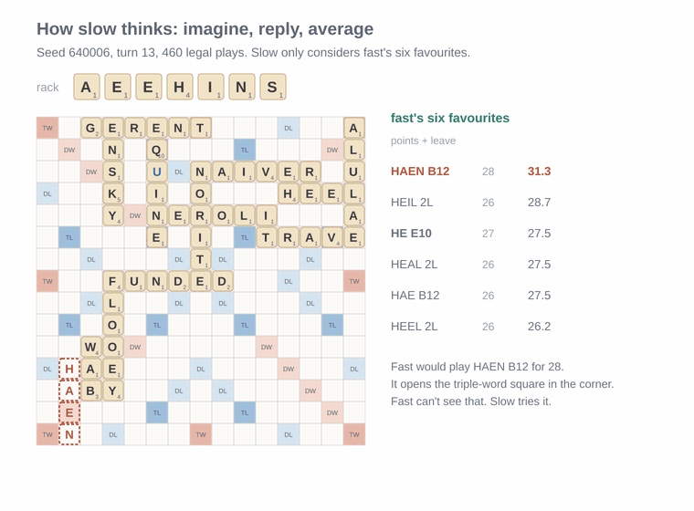

*Fast wants HAEN for 28, which puts a tile next to the bottom-left triple-word square. In one imagined world the opponent answers with NONBASIC along the bottom row for 83. Over all 20 worlds, HE for 27 comes out about 9 points better.*

Slow beat fast in 58% of 200 games, by 17 points a game. It was the first clear win since the leave bot.

I also tried thinking a level up: choose a plan for the next few turns (open the board, close it, dump tiles) by imagining 12 futures under each plan. The planner played exactly like a player that switched plans at random. Twelve games can't tell close plans apart. A plan that truly wins half the time will win anywhere from 3 to 9 of 12 just by luck. The one plan that was clearly different, dumping tiles, was clearly worse. It won 44% against steady, the refitted quick rule below. Swapping plays no tiles, so it never swapped: in 40 games, not once, at 22 turns where steady would have.

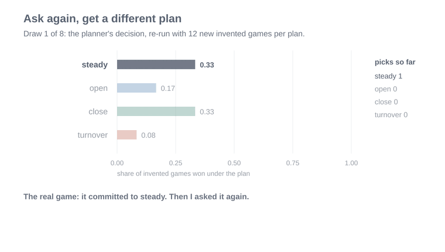

*One real decision by the planner, asked again eight times with 12 new imagined games per plan, then once with 300. With 12 its answer keeps changing; even with 300, three of the four plans can't be told apart.*

The problem with slow is that it was too **slow** to be the player, so I tried to teach fast what slow knows. I recorded 1,825 of slow's decisions and refitted fast's rule to them (readers may notice the parallel: strong players do this too, turning slow analysis into quick instinct), with a few new things to weigh, like how many premium squares a move opens up. The biggest lesson was the defence champion_1 had guessed at, but narrower: each triple-word square a move newly opens costs about 3.4 points. The refitted rule, which I'll call **steady**, kept at most a fifth of slow's edge. Teaching it again, and again, went flat.

The reason is simple once you see it. Slow knows "what can the opponent score after this?" because it tries it. Fast has a handful of counts standing in for that, and a stand-in can only hold so much.

## Neural networks to the rescue

Steady stalled because of what it could look at. To judge a move it had points, the leave, and a few counts like "how many triple-word squares does this open". Slow sees much more, because it plays the move out and watches what the opponent does with the board. That's the HAEN position from earlier: the danger wasn't one open square, it was NONBASIC fitting along the bottom row. No count I could write captures that. So the quick player needed to look at the board itself and work out for itself what matters.

That's the choice DeepMind made in [AlphaGo Zero](https://doi.org/10.1038/nature24270) and AlphaZero: the quick judge is a neural network that looks at the raw board and learns what matters from games, instead of a list of features someone wrote by hand. It isn't only for games without luck, either. [TD-Gammon](https://doi.org/10.1145/203330.203343) taught a network to judge backgammon positions, dice and all, back in the 1990s, and in 1998 it lost a 100-game series to the world champion by only 8 points.

So I replaced the rule with a small neural network that reads the board as a picture, the way image networks do, plus the exact tiles kept. Small 3×3 filters slide over the board and can pick up patterns like "an open triple-word square with an empty square next to a tile, two rows away", which none of my hand-picked numbers could. It learned from 18,000 games of steady playing itself.

> **How the network is used, and what it learns from**
> - It doesn't choose from all 2,000 moves. It takes steady's top ten, adds its guess of how the rest of the game will go, and plays the best total.
> - For each position, it learns how many points the player went on to gain or lose over the rest of the game. That's a noisy target, because a whole game of draws sits inside every label.

One thing it learned is humbling. After a move, what happens in the rest of the game swings by about 63 points either way. The network's guesses explain about 3% of that. The rest is the tiles each player is about to draw.

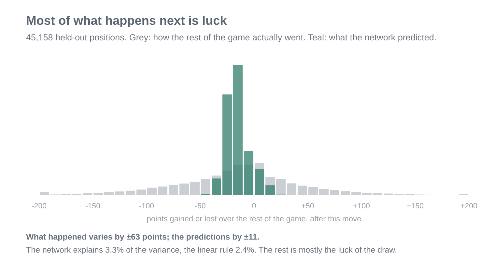

*45,158 positions the network never trained on. Grey is how the rest of the game actually went; teal is what the network predicted.*

The fair test was against the old rule refitted on exactly the same games. The network won by about 7 points a game. Here's the kind of move the difference comes from:

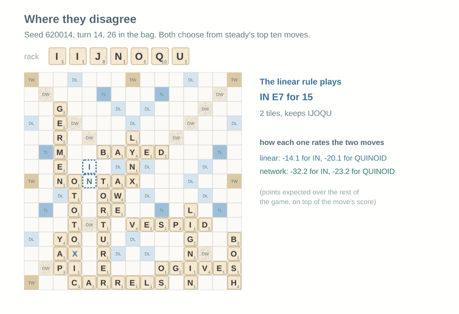

*The rack has a Q and a J. The old rule plays IN for 15 and keeps IJOQU. The network plays QUINOID for 21, gets rid of the Q and keeps only the J.*

Any Scrabble player would play QUINOID. The old rule didn't, because it had learned a flat charge for every tile played, and QUINOID plays four more. The network sees that sitting on a Q and a J is expensive.

Two ideas from a much bigger network, [César Del Solar's](https://www.cesardelsolar.com/posts/2025-06-21-nn-scrabble/), made mine worse: reading the actual letter on every square, and predicting the win instead of the score. His was trained on 7.5 million games; mine on 18,000. My guess is that richer inputs need more games than I had. What did help was smaller: a wider network, and showing every board flipped corner to corner, which is a true symmetry of the board. That version beat steady 53% of the time on fresh bags, the first quick player to do so.

## Against a real game solver: HastyBot

Up to here, my game solvers only played each other. That says which of my bots is better, not whether any of them is good. So I set up HastyBot, the quick bot in [Macondo](https://github.com/domino14/macondo), the strongest open-source Scrabble engine I know of: the best-scoring move after a well-tuned leave table, no looking ahead.

> **How the match works**
>
> HastyBot runs inside Macondo on a cloud machine, with my word list and Macondo's own leave table. Each of its moves is matched back into my engine by the tiles it puts down, so both players play the same game under the same rules.

My network won 53.3% of its first 1,000 games against HastyBot. That looked like the headline. But again, the luck factor came in. To be sure I'd really beaten HastyBot, I had set a rule beforehand: a win only counts if a rematch on 2,000 fresh bags agrees. The rematch said 49.3%, which is level.

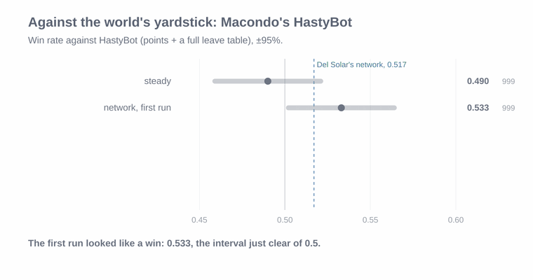

*The first run, the rematch decided before it, and the two together.*

For scale, Del Solar's network, trained on 400 times as many games, wins 51.7% against HastyBot. At this level the gaps are a couple of percent, and a single good-looking run tells you very little.

## There's always light at the end of the tunnel

Here's a first-principles point I'd missed. Scrabble hides two things, the other rack and the bag order, but not for the whole game. Count the tiles: you know all 100, you can see the board and your own rack, and once the bag is empty, every tile you can't see must be on the other player's rack. From that moment, nothing is hidden. Both players know everything, like a chess endgame.

That changes what good play means. In the middle of the game you play for points and a good leave, because the next draw is a guess. In the endgame there's no next draw, so the leave stops mattering and only one question is left: how does this play out from here, move by move? Usually that comes down to a few things:

- **Going out first.** Whoever uses their last tile ends the game and collects twice the value of the other player's leftover tiles.
- **Blocking.** If you can see that the other player has a big play waiting, the right move might be the one that takes away that spot, even for fewer points.
- **Getting rid of the expensive tiles.** A Q or Z stuck on your rack when the other player goes out hands them 20 points.

With no luck left, a computer doesn't have to guess any of this - and this becomes an exact search. It can try every sequence of moves to the end of the game and find the best one exactly. Macondo has a solver that does this.

> **One caveat**
>
> The solver looks 6 moves ahead. That's exact for most endgames but not all: in one of the games below, steady's move came out 1 point *better* than the solver's "best".

This sounds amazing, but before building anything, I wanted to know whether it was worth it. I wrote a heuristic rule: build it if steady loses 5 or more points a game here, skip it if under 2. Then I took 320 games of steady playing itself, stopped each one on the first turn after the bag ran out, and asked the solver two things. What's the final score if both sides play perfectly from here? And what's the final score if steady makes its usual move, and both sides play perfectly after that?

The difference is what that one move costs. On average, steady gave away **about 9 points a game**, on a single move. In 11 of the 320 games, that one move turned a win into a loss.

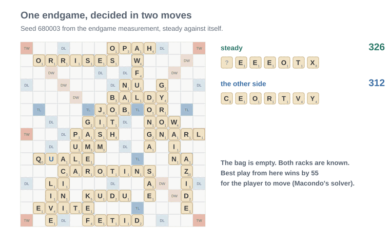

*The worst one. Best play wins by 55. Steady spends its blank on TEXt for 48, and loses by 14. The opponent could already go out with COVERTLY, and none of steady's 12 favourite moves blocks it.*

That's the whole problem in one picture. Steady looks at its own points and its own leave. It never looks at the other rack, even at the one point in the game when it can know that rack exactly.

So the next step was to add the solver and see what it's worth. To measure that cleanly, I wanted to change one thing only.

I started from a player that's already level with HastyBot, and the simplest one is HastyBot itself. So I rebuilt it inside my engine: the highest-scoring move after HastyBot's own leave table, read straight from its file. The copy isn't perfect. It picks the same move as the real HastyBot 85.5% of the time, probably because Macondo adds a few extra rules near the start and end of a game that I didn't copy. But it plays level with HastyBot, which is what a copy should do.

Then I made a second version that's identical, except that once the bag is empty it hands over to Macondo's solver. On the same bags, the two make exactly the same moves until the bag runs out. Everything before that point is shared, so any difference in the final score comes from the endgame and nothing else. That makes it the cleanest comparison in this post:

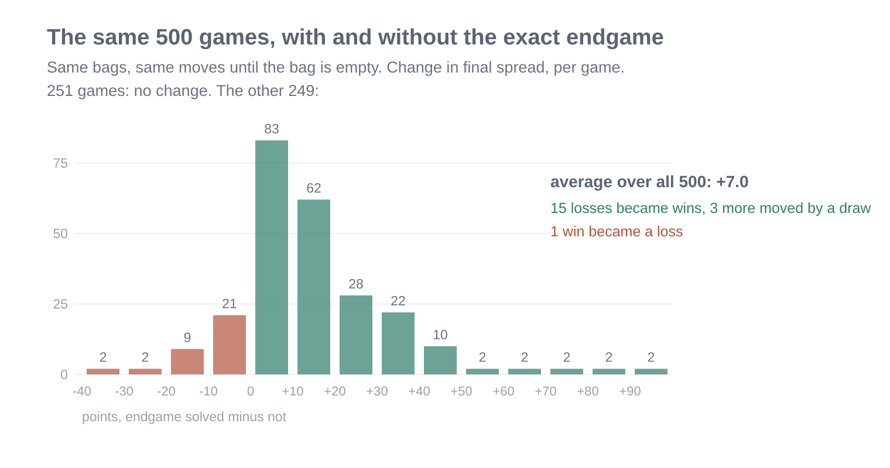

*The same 500 games with and without the exact endgame. Half came out the same. Over all 500, solving the endgame gained 7 points a game.*

The solver gained about 7 points a game against HastyBot. In 15 games a loss became a win, and in 1 a win became a loss.

Then the rematch rule again: guess written down first (54 to 56%), 1,000 fresh games, run once. It won **54.7%**, by 9 points a game, with each move taking under half a second. That's the first win in this post that held up.

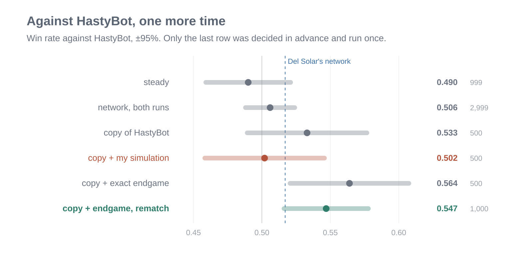

*Everything against HastyBot so far. Only the last row was decided in advance and run once. My own simulation (red) made the copy worse.*

To be clear about where it came from: HastyBot's own leave table plus a perfect endgame. Nothing in it was learned by my bots. It beats HastyBot by being exact at the one point in the game where guessing is no longer needed.

I also tried what strong engines do in the middle game: simulation, like slow, with my own code. It made the player worse, by 15 points a game.

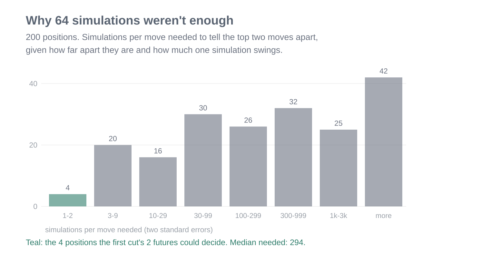

*For each of 200 positions, how many imagined futures it takes to tell the top two moves apart.*

In a typical position the top two moves are 3 points apart, and one imagined future swings the difference by about 25. The middle position needs about 290 futures per move to tell them apart. Mine could afford 64 in total. Too little simulation is worse than none: the noise outvotes a good first guess.

## Playing in the dark

That leaves the hard part of the game. There are three ways to handle tiles you can't see:

- **Wait until nothing is hidden**, then be exact. That's the endgame above.
- **Average over what's hidden.** Deal the other side random racks, play a few turns forward, average. Slow and noisy, but honest about not knowing.
- **Narrow down what's hidden.** What someone plays, and what they don't, says something about what they kept. Good players track tiles and read racks, the way poker players reason about ranges.

My player did only the first: it knew nothing about the other rack until the bag was empty. BestBot, Macondo's strongest bot, also does the other two. It simulates, and it guesses what's on the other rack.

The obvious test was to play BestBot itself. But on my cloud machine it plays about one pair of games every 45 minutes, so a 1,000-game match would take more than two weeks of non-stop running. Instead, I built a stand-in from Macondo's own parts and played that.

> **The stand-in, and what it isn't**
> - It takes HastyBot's top 15 moves, simulates each one two turns ahead, and stops once it's 99% sure which is best. Then it uses the same exact endgame as my player. It takes about 8 seconds a move.
> - It doesn't guess the other rack, and it doesn't solve the last few turns before the endgame. The real BestBot does both, so the stand-in is weaker.
> - So tying or beating the stand-in only says my player matches *BestBot's method without rack reading*, at the same thinking time. It says nothing direct about BestBot.

Against the stand-in, my player won 42%.

To find where the losses came from, I took 200 of those games and re-scored every one of my player's 2,068 moves with a stronger simulation. The losses weren't bingos or swaps. They were ordinary 20-point moves in the middle of the game, a few points at a time. Here's the middle-game move it rated worst:

> **The stronger simulation**
>
> It looks three turns ahead instead of two, considers its own top 20 moves plus my player's, and takes 15 seconds a move. It's a better judge, not a perfect one: it still has to deal random racks for the opponent.

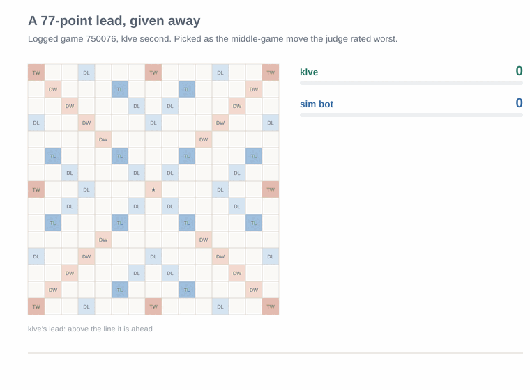

*Replayed from the match and checked against the final score. klve is my player; the red outline is the stronger simulation's pick.*

My player is 59 ahead with 15 tiles in the bag. It plays AY for 18 and goes 77 up. But AY opens the top row and its triple-word squares. The stronger simulation preferred AIRY, for 24, which keeps it shut. I checked with the rack the opponent actually drew: after AY, its best move was worth 87, and it played QUERY for 60. After AIRY, its best would have been 39. Two turns later a bingo with both blanks finished the lead.

The fix was to stop pretending my player didn't need simulation, and borrow the opponent's: Macondo's simulator for the middle game, with no more thinking time per move than the opponent gets: 7.6 seconds each, on average. Guess written down first, about 51%. Over 1,000 fresh games it won **50.5%**. Level. That's what you'd expect when two players use the same method with the same endgame.

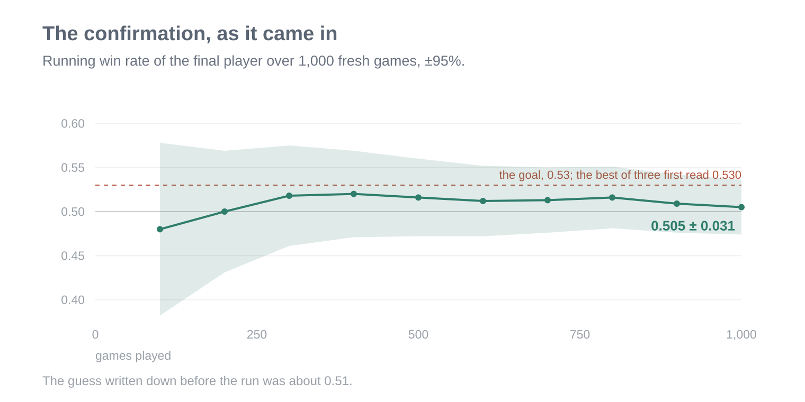

*The 1,000-game rematch as it came in, every 100 games. It started below 50%, sat just above for most of the run, and finished at 50.5%.*

That's level with a stand-in at equal time, not with BestBot. The real one also reads racks, so I'd expect it to beat my player. I haven't measured by how much.

One detour taught me something. The re-scoring said the turns with one to seven tiles left in the bag looked very costly per move, so I built a fix for those first and played it 300 games. It showed nothing. Checking afterwards on the logged positions, the fix was sound, but those turns are rare: worth about 1% a game, far below what 300 games can see. Now every fix gets checked on logged positions first, which takes minutes, before it gets a match.

Last, the third way. Before building a rack reader, I measured the most it could ever be worth: a version of my player that __cheats__, whose simulations get the opponent's real rack. On the same bags as the honest player, it won 12 points more of win rate and 33 points a game. That's the biggest number in this post. A real rack reader only narrows the rack down, so it will get part of that. But that's where the next gain is.

> **Why build a cheat at all?**
>
> It never plays for real. Giving the simulation the true rack shows the most that rack reading could ever add. I wrote the bar down first: under 3 points of win rate, don't build a rack reader; 6 or more, build it. It came in at 12.

## The highlight reel

Replaying thousands of games for this post turned up some moves worth a look, from bots on both sides of the board.

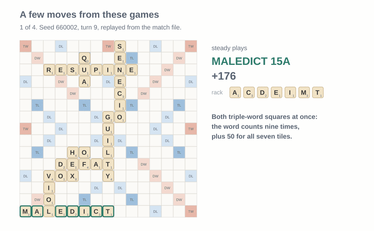

*Each replayed from its match and checked against the recorded result: the biggest single move, two ten-letter words, and two tiles for 59. The names are bots from the sections above; turnover is the tile-dumping plan.*

## Conclusion

- **Luck is most of a game.** Twice, a good-looking first result didn't survive a rematch on fresh bags. Writing the guess down before the run and playing the chosen player once on new bags is the only reason this post doesn't claim wins it didn't have.
- **A language model writes what it already knows.** One reply got from greedy to textbook Scrabble. After that it was guessing, because it saw a score and never a game.
- **Ask what the player can't see.** Every real gain lined up with something the player couldn't see before: what a move opens on the board (slow thinking, the network), the endgame where nothing is hidden (the exact solver), and next, the other rack.
- **Be exact where you can.** The cleanest win came from the one stretch of the game with no hidden information.
- **Measure before building.** Measuring the endgame said build it. Measuring the cheating ceiling says read racks next. The one fix I built from an unchecked number did nothing.

And plainly: the best player today is mostly borrowed. HastyBot's leave table, Macondo's simulator and its solvers. The language model's lasting contribution was one good reply early on.

This whole experiment made me realize just how much goes into solving a game from first principles. Scrabble is a really difficult game to model, but at the same time, it gives me hope that a library like mine can be pointed at something as complicated as Scrabble. Discovery agents are really awesome, and the fact that I could beat a benchmark bot like HastyBot on limited compute gives me hope. Cadence is really fun to work with, and these kinds of experiments show how to probe LLMs on actual hard problems. LLMs have enabled me to carry out experiments like these, so I'm very hopeful for the future.
